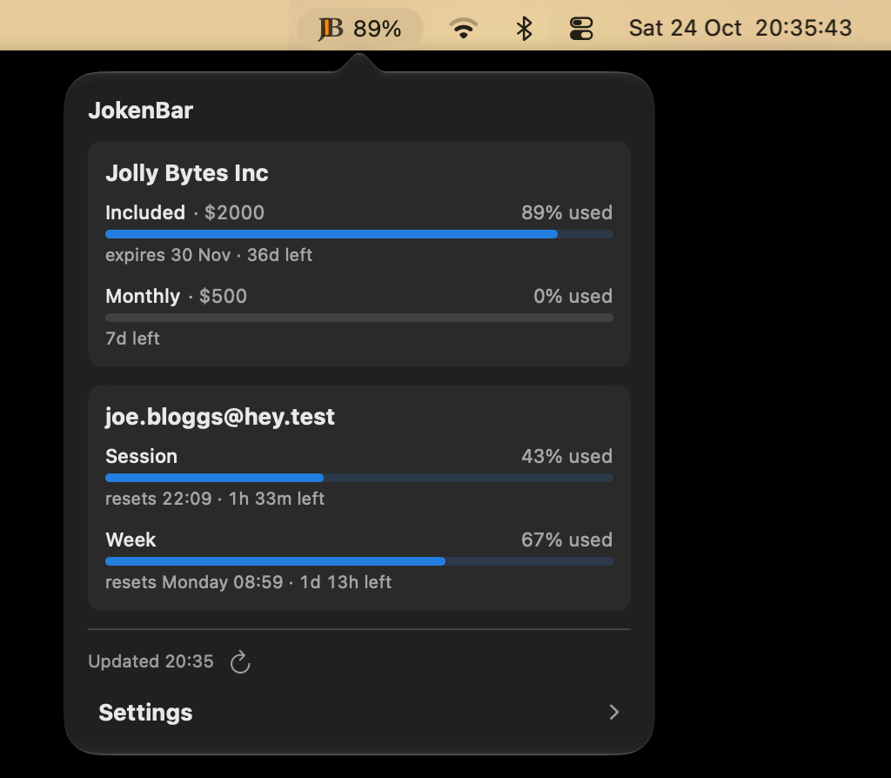

# JokenBar

**Your Claude limits, one glance away.**



A tiny macOS menu bar app for Claude and Claude Code. Your work and personal
accounts side by side: Enterprise included usage and monthly limit, Pro/Max
session and weekly limits. The JB turns orange at 75% and red at 90%.
Press **⌃⌥J** from anywhere.

## Install

macOS 14 or later. Paste into Terminal:

```sh
curl -fsSL https://raw.githubusercontent.com/chei/JokenBar/main/install.sh | bash
```

Run it again to update, or build it yourself with `scripts/build-app.sh`
(Command Line Tools are enough). Then click **JB** → **Add Account…** and sign in to
claude.ai as usual. More accounts go under **Settings ›**.

## Privacy

JokenBar talks only to claude.ai and reads the same numbers as its Usage page.
You sign in on claude.ai's own page; the app never sees your password and
stores no tokens. It's not affiliated with Anthropic and relies on undocumented
endpoints, so a change on their side can break it.

## Uninstall

Right-click **JB** → **Quit JokenBar**, then:

```sh
rm -rf /Applications/JokenBar.app ~/Applications/JokenBar.app \
  ~/Library/WebKit/io.github.chei.jokenbar ~/Library/Caches/io.github.chei.jokenbar
defaults delete io.github.chei.jokenbar
```

## Development

```sh
scripts/test.sh        # unit tests
scripts/build-app.sh   # dist/JokenBar.app
```

To release, bump `VERSION` and push to `main`.

## License

[MIT](LICENSE)
